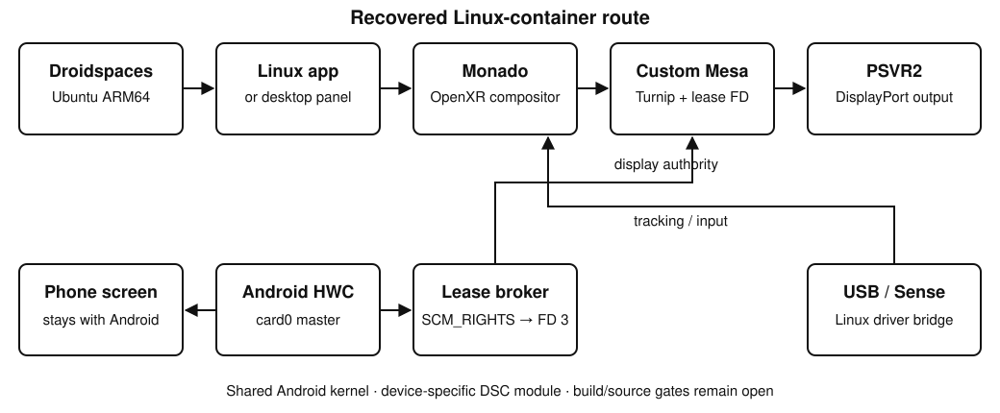

# PSVR-2-DroidXR

Explore the [DroidXR engineering journal](https://astroskyoffical.github.io/PSVR-2-DroidXR/?v=journal-9).

## Linux-container method

This guide records the existing Linux PCVR route on a rooted RedMagic phone: Droidspaces hosts an ARM64 Linux container, custom Mesa renders on the phone GPU, and Monado presents to PSVR2 through a DRM lease. The Android screen stays with Android.

**Release status: documentation and pinned component identities; a complete fresh-install bundle is not available.** The production DSC module lacks matching source, and the custom Mesa/Monado build provenance, rootfs image origin, and installed Android display app's source identity still need recovery. See [release gates](guides/linux-container/docs/licenses-and-provenance.md). Do not substitute an arbitrary kernel module or stock graphics driver.

This route is separate from the native Android/Bionic OpenXR work. Windows drivers running through Wine in the container do not establish native Android completion.

**Downloads:** no custom app APK, DSC module, Mesa driver or Monado binary is included in this publication. The component pages identify the missing files and source/build records; official upstream links are references, not a tested replacement bundle.

## Recorded baseline

| Component | Recorded identity |
|---|---|
| Phone | NX809J / RedMagic; Android 16, API 36; AArch64 |
| Kernel | `6.12.23-android16-OP-WILD` |
| Container manager | [Droidspaces](https://github.com/ravindu644/Droidspaces-OSS), Android app 6.3.0 / code 6300 |
| Container OS | Ubuntu 26.04 LTS, Resolute Raccoon; `arm64` package records |
| Container label | `AnLandKDE` — a local name, not the distribution identity |
| Android display app | `com.anland.linkdoctor.next`, 1.0.0-preview / code 100 |
| Graphics | Two custom Turnip libraries, separately selected for compositor and apps |
| Runtime | Linux `/opt/psvr2/runtime/monado-ign`; exact hashes in the [manifest](guides/linux-container/manifest.json) |

These identities come from preserved files and a read-only inventory. The release review did not launch the container, create a lease, or repeat a headset test. Other phones, kernels, container managers and rootfs images remain untested by this method.

## Setup order

1. Read [device and DSC requirements](guides/linux-container/docs/device-and-dsc.md). Match the phone/kernel before considering a module.
2. Follow the official [Droidspaces](https://www.droidspaces.org/) project, then match the [container settings](guides/linux-container/docs/droidspaces.md). The original rootfs image receipt is still missing.
3. Identify [the Android display app and launch scripts](guides/linux-container/docs/linkdoctor-and-launchers.md). The local APK build differs from the installed APK; neither is bundled here.
4. Recover and install the exact [custom Mesa builds](guides/linux-container/docs/mesa.md), with their matching source, patches and notices.
5. Recover the [Linux Monado runtime and tracking dependencies](guides/linux-container/docs/monado-and-input.md). Obtain proprietary software through its authorized channels.
6. Understand the [DRM lease handoff](guides/linux-container/docs/drm-leasing.md) before starting the display. One compositor owns headset presentation.
7. Use the [verification and restore sequence](guides/linux-container/docs/verify-and-restore.md) on the already provisioned baseline. Process startup alone does not prove useful tracking or a visible scene.
8. Add [optional test apps](guides/linux-container/docs/optional-test-apps.md) only after the headset path works.

Each component page explains its role, recovered installation evidence, checks and restoration limits. Missing artifacts are identified where they block a step. This package contains no APK, kernel module, graphics/runtime binary, rootfs image, proprietary driver, game asset, private log or signing key.
