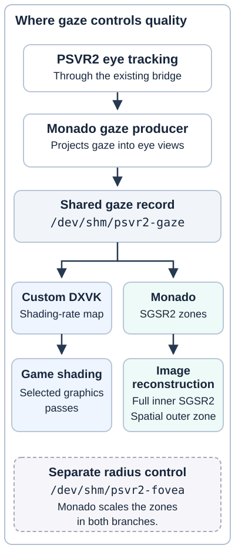

<!-- Copyright (C) 2026 AstroPC (astroskyoffical)
SPDX-License-Identifier: GPL-3.0-only
Original project documentation only. Upstream components retain their terms. -->
# DXVK eye-tracked foveation for the phone

These patches contain the gaze-enabled DXVK code from the phone-tested Skyrim VR build.
Eye-tracked foveation works in AstroPC's PSVR2 phone setup.
SGSR2 also works and improves the image.

Use this guide with the existing Linux-container setup.
The [technical reference](TECHNICAL-REFERENCE.md) lists the required runtime, tool versions and source pins.
[Download the source package](https://raw.githubusercontent.com/astroskyoffical/PSVR-2-DroidXR/main/research/dxvk-gaze/psvr2-dxvk-gaze-source-20261014-r2.zip).

## What it does

DXVK translates the game's D3D11 graphics commands into Vulkan commands.
The custom code reads gaze coordinates from Monado, the VR runtime.
It uses a shading-rate map to control shading detail in selected game passes.

Monado then uses SGSR2 to reconstruct the rendered image.
It applies RCAS sharpening before the later lens-distortion step.
Display Stream Compression (DSC) compresses the display link after these rendering steps.

## Visual flow

**Text alternative:** The game sends graphics commands through DXVK and the game Turnip driver.
The phone GPU renders the eye images and depth.
OpenComposite submits those views to Monado through OpenXR.
Monado reconstructs the image, applies sharpening and applies lens distortion.
The separate compositor driver presents the result through the display path to PSVR2.

OpenComposite translates the game's OpenVR calls into OpenXR calls.
It provides the API handoff, not an additional image filter.
Solid arrows show the graphics and image path.
The dashed arrow shows the VR API calls.

Detail: gaze and image-quality control

**Text alternative:** Monado writes gaze coordinates to `/dev/shm/psvr2-gaze`.
DXVK reads the file through Wine's `Z:` mapping and updates its shading-rate map.
Monado also reads the file to position its SGSR2 zones.
The separate `/dev/shm/psvr2-fovea` record scales the zones in both paths.
The [record layouts](TECHNICAL-REFERENCE.md#shared-records) define the fields.

## Required files

- [Patch 0001](0001-retained-d3d11-timing-base.patch) contains the recorded timing base. Timing stays off unless `DXVK_INTEROP_TIMING=1`.
- [Patch 0002](0002-recovered-dxvk-gaze-foveation.patch) contains the recovered gaze-foveation changes.
- [Game settings](skyrim-foveation.env.example) and [Monado settings](monado-sr.env.example) record the phone configuration.
- [Patch 0003](0003-OPTIONAL-new-gaze-map-trace.patch) adds optional trace code. It is separate from the phone-tested build.

Build patches 0001 and 0002 against the [pinned upstream source](TECHNICAL-REFERENCE.md#build-the-dlls).
Use Windows x64 DLLs through the existing Proton/FEX route.
Keep the game driver separate from the compositor driver.
An ICD is a Vulkan driver selected through a JSON file.

Preserve the [project terms](PACKAGE-TERMS.md), [GPL text](LICENSE-GPL-3.0.txt) and [DXVK notice](LICENSE-DXVK.txt).
The package contains source patches, settings, diagrams and instructions.
The runtime and game remain external prerequisites.

## Install

The phone owner controls this procedure.
If you only need the source records, keep the current DLLs.
Do not replace files in a running game.

1. Stop the game through its current launcher.
2. Create a new backup directory.
3. Copy both current DLLs, the game environment and the selected ICD JSON files to that directory.
4. Record the SHA-256 hashes of the backup files.
5. Preserve the current Monado runtime state.
6. Copy the intended `d3d11.dll` and `dxgi.dll` pair into the game directory.
7. Keep the current native-DLL overrides for D3D11 and DXGI.
8. Merge the game settings into the current game environment.
9. Export the assignments through the current launcher, as shown in the [reference](TECHNICAL-REFERENCE.md#export-the-settings).
10. Select the game ICD for the game.
11. Select the compositor ICD for Monado.
12. Use the Monado settings with the existing integrated service.
13. Keep OpenComposite's `upscaler=monado` and projection-depth route.

Do not enable the OpenComposite and Monado upscale paths at the same time.
Change a target size only after the pass log identifies the new render size.
Do not replace system Vulkan libraries.

## Check

1. Record the installed DLL hashes.
2. Start a known Skyrim scene through the current launcher.
3. Check that the game process maps the intended DLL pair and game ICD.
4. Check the image in PSVR2.
5. Use the [bounded trace procedure](TECHNICAL-REFERENCE.md#check-gaze-to-map-updates) if you need a gaze-to-map record.

The [provenance file](provenance.json) identifies the retained build and its source inputs.
The [reference](TECHNICAL-REFERENCE.md#read-the-results) explains the trace result and GPU-work measurements.

## Restore

1. Stop the game.
2. Restore both DLLs from the backup directory.
3. Restore the saved game environment.
4. Restore the saved ICD selection.
5. Restore the saved diagnostic log settings.
6. Check the restored file hashes against the backup record.
7. Start the game through its original launcher.
8. Keep the backup directory.

To disable foveation for a later comparison, set `DXVK_FOVEATION=0`.
Restart the game after this change.
DXVK reads the configuration once per process.

## Reference files

- [Build, runtime and test reference](TECHNICAL-REFERENCE.md).
- [Source and build identities](provenance.json).
- [Current text-payload hashes](SHA256SUMS.txt).
- [Source-archive hashes](SOURCE-ARCHIVE-SHA256.txt).
- [Rendering explanation and upstream credit](https://github.com/astroskyoffical/PSVR-2-DroidXR/blob/main/guides/foveated-rendering.md).
